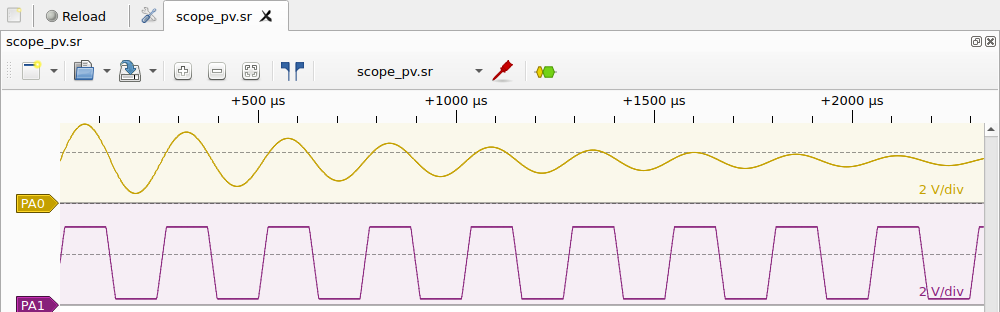
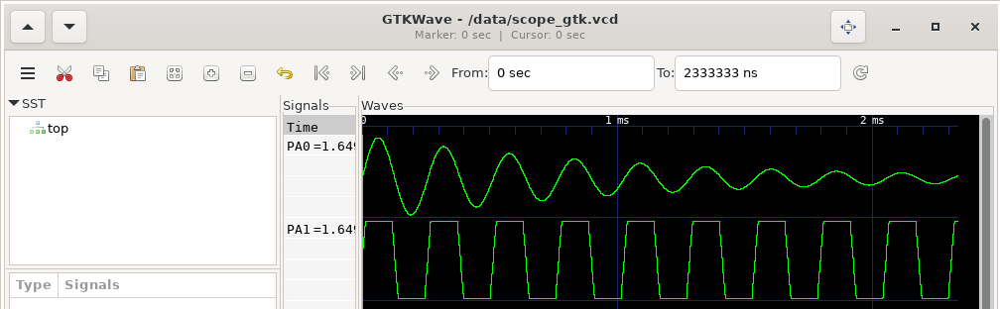

# buck50

Open-source firmware and host software that turn a US$1.50 "Blue Pill"
STM32F103 board into a USB test and measurement instrument: logic analyzer,
oscilloscope, protocol bridge, signal generator and live monitor.

This repository is the [Zektopic](https://github.com/Zektopic) fork of
[thanks4opensource/buck50](https://github.com/thanks4opensource/buck50) by
Mark R. Rubin. It adds a faster capture mode, export to more waveform
viewers, a reproducible build, and automated tests. See
[What this fork changes](#what-this-fork-changes).

## Contents

- [Features](#features)
- [Status](#status)
- [Requirements](#requirements)
- [Quick start](#quick-start)
- [Pin assignments](#pin-assignments)
- [Viewing captures](#viewing-captures)
- [Logic analyzer capture modes](#logic-analyzer-capture-modes)
- [Building the firmware](#building-the-firmware)
- [Testing](#testing)
- [Documentation](#documentation)
- [What this fork changes](#what-this-fork-changes)
- [Contributing](#contributing)
- [License and credits](#license-and-credits)

## Features

| Function | Details |
|----------|---------|
| Logic analyzer | 8 channels (PB4-PB11), 6.26 MHz, about 4800 samples. Samples are stored only when an input changes, each with a 13.9 ns resolution timestamp, so capture length depends on signal activity, not time. |
| Triggering | User-defined state machine: sequences ("A then B then C") and alternatives ("A or B or C") over the 8 inputs. Several boards can be ganged to trigger together for more channels. |
| Oscilloscope | 1 or 2 channels (PA0-PA7), 12 bit, up to 857 kHz, about 4800 samples dual or 9600 single, level and slope trigger with hysteresis. |
| Live monitor | Continuous display and logging of digital inputs, analog inputs, USART, SPI and I2C traffic. |
| Protocol bridges | USART (async and synchronous), SPI (master and slave), I2C (master and slave) to the host terminal, a UNIX socket, or a pseudo-terminal. |
| Signal generation | 3-channel pulse generator with per-channel duty cycle and polarity; 8-bit parallel counter (binary or Gray code); 8-bit parallel output from host data. |
| Host program | `buck50.py`: interactive command line with tab completion, built-in help for every command and parameter, and save/load of configurations. No GUI; captures open in [external viewers](#viewing-captures). |

## Status

Read this before flashing.

| Component | Version | Verified by |
|-----------|---------|-------------|
| Firmware in `build/` | 0.9.3 | Reproducible build; emulated tests of the capture code. **Never run on hardware.** |
| Firmware, original | 0.9.2 | The original author, on hardware. Get it with `git show e77172a:build/buck50.bin > buck50-0.9.2.bin`. |
| `buck50.py` | 0.9.7 | End-to-end tests against a simulated device; export formats loaded in the real viewers. Works with firmware 0.9.2 and 0.9.3. |

If you need something known to work today, flash 0.9.2 and use the
`buck50.py` from this repository: everything except `logic mode=edge`
works with it. If you can test 0.9.3 on a board, the steps are in
[ROADMAP.md](ROADMAP.md) and results are very welcome.

## Requirements

- A "Blue Pill" (STM32F103C8 or CB) and a way to flash it once: an ST-Link
  or Black Magic Probe on the SWD pins, or a USB-serial adapter on USART1.
- Linux, or another UNIX-like system with `/dev/ttyACM*` serial devices.
- Python 3.9 or later (tested on 3.9, 3.12, 3.13 and 3.15). No third-party
  packages are needed to run `buck50.py`.
- Optional, for viewing captures: gnuplot, PulseView, or GTKWave.

## Quick start

**1. Flash the firmware** (once). With an ST-Link and
[stlink](https://github.com/stlink-org/stlink):

    st-flash write build/buck50.bin 0x08000000

or with OpenOCD:

    openocd -f interface/stlink.cfg -f target/stm32f1x.cfg \
            -c "program build/buck50.elf verify reset exit"

**2. Connect** the board's USB port. It appears as a CDC-ACM serial device,
normally `/dev/ttyACM0`. Your user needs access to it (on most distributions,
membership of the `dialout` group).

**3. Run the host program:**

    $ build/buck50.py              # or: build/buck50.py /dev/ttyACM1
    Connecting to buck50 device (press CTRL-C to abort ...  )
    Firmware identity match: 0xea017af5
    Firmware version  match: 0.9.3
    $1.50:

**4. Try it.** Everything is a command at the `$1.50:` prompt; `help`,
`help <command>` and the TAB key explain the rest.

    $1.50: monitor                           # watch PB4-PB11 live
    $1.50: logic edges=32                    # capture 32 changes on PB4-PB11
    $1.50: dump digital-frmt=vcd file=capture    # save as capture.vcd

Trigger on a rising edge of PB8, then capture:

    $1.50: trigger 0=xxx0xxxx-1-0  # wait for PB8 low
    $1.50: trigger 1=xxx1xxxx-0-1  # then for PB8 high
    $1.50: logic edges=32

Two-channel oscilloscope on PA4 and PA5, triggering at 1.65 V rising:

    $1.50: oscope trgr-chnl=4 scnd-chnl=5 trigger=0:3.3:0.15:0.01

USART bridge to a pseudo-terminal, 1 kHz pulses on PA1-PA3:

    $1.50: usart ipc external pty enable
    $1.50: pulse enable

**No board?** `test/fake_buck50.py` simulates one well enough to explore
`buck50.py`'s `logic`, `oscope` and `dump` commands:

    $ test/fake_buck50.py
    Fake buck50 device on /dev/pts/7 -- run:
        buck50.py -x /dev/pts/7

## Pin assignments

| Pins | Direction | Used for | Commands |
|------|-----------|----------|----------|
| PB4-PB11 | in, weak pull-down | Digital inputs | `logic`, `monitor` |
| PA0-PA7 | in, analog | Analog inputs | `oscope`, `monitor` |
| PA0-PA7 | out | Parallel digital output | `numbers`, `gpio` |
| PA1-PA3 | out | Pulse outputs | `pulse` |
| PA0-PA3, PA8-PA10 | in/out | USART (CTS, RTS, TX, RX; clock, TX, RX) | `usart`, `monitor` |
| PA4-PA7 | in/out | SPI (select, clock, MISO, MOSI) | `spi`, `monitor` |
| PB10, PB11 | open-drain | I2C | `i2c`, `monitor` |
| PB13 | out | Sampling indicator / sync | `logic`, `oscope` |
| PB14, PB15 | open-drain | Ganged trigger and acknowledge | `logic`, `oscope` |
| PC13 | out | On-board LED: on = connected, off = sampling, 4 Hz blink = fault | all |
| PA11, PA12 | | USB. Do not connect. | |

Inputs are 3.3 V logic. Wiring an output to a supply rail or to another
output can permanently damage the board. The
[manual](docs/MANUAL.md#hardware_connections) has the full table and the
annotated pinout diagram.

## Viewing captures

`buck50.py` saves captures with the `dump` command and can launch a viewer
automatically. At startup it selects formats for whichever viewer it finds
installed (gnuplot first, then PulseView, then GTKWave); `-x` disables that.

| Capture | `dump` setting | gnuplot | PulseView, sigrok-cli | GTKWave |
|---------|----------------|:-------:|:---------------------:|:-------:|
| Logic analyzer | `digital-frmt=csv` | yes | | |
| Logic analyzer | `digital-frmt=vcd` | | yes | yes |
| Oscilloscope | `analog-frmt=csv` | yes | | |
| Oscilloscope | `analog-frmt=sr` (sigrok session) | | yes | |
| Oscilloscope | `analog-frmt=vcd` (plus `.gtkw` display settings) | | | yes |

Logic captures saved as VCD can be decoded with sigrok's protocol decoders,
in PulseView or from the command line:

    $1.50: dump output=file file=capture digital-frmt=vcd viewer-vcd=pulseview
    $ sigrok-cli -i capture.vcd -I vcd -P uart:rx=brn:baudrate=115200 -A uart=rx-data

(`brn`...`gry` are the default names of PB4...PB11; change them with
`configure lines`.)

Oscilloscope captures in PulseView (`analog-frmt=sr`) and GTKWave
(`analog-frmt=vcd`):

Every "yes" in the table is checked by `test/test_viewers.py` against the
programs' own file readers: sigrok-cli 0.7.2 with libsigrok 0.5.2 (the
library PulseView uses), GTKWave 3.3.116's `vcd2fst`, and gnuplot 6.0;
PulseView 0.4.2 and the GTKWave GUI were also checked by hand, which is
where the screenshots come from. The data in those checks and screenshots is
from the simulated device, not from a board.

Not supported: Saleae Logic 2 cannot import captures made by other tools.
For anything else, CSV is plain `time,channel,...` text, and
`viewer-csv=other` / `viewer-vcd=other` run a command of your choice.

## Logic analyzer capture modes

Selected with `logic mode=`. Poll rate is how often the inputs are examined;
a change is timestamped when the next poll notices it.

| Mode | CPU cycles per poll (72 MHz) | Poll rate | Notes |
|------|------------------------------|-----------|-------|
| `6.26MHz` (default) | 11, 11, 11, 11, 11, 14 | 6.26 MHz | Fastest measured mode |
| `irregular` | 11, 14 | 5.76 MHz | |
| `uniform` | 15 | 4.80 MHz | Constant interval |
| `4MHz` | 18 | 4.00 MHz | Constant interval, round number |
| `edge` (experimental) | 6-7 while inputs are quiet; 17 after a stored change | about 10-11 MHz quiet, 4.2 MHz busy | **Estimated, not measured.** Firmware 0.9.3 or later |

The first four rows are the original author's measurements on hardware. The
`edge` row is a prediction from a cost model fitted to those measurements;
see the [manual](docs/MANUAL.md#edge_mode) for how the mode works, what it
trades, and how to measure it on a board.

## Building the firmware

The repository includes ready-to-flash `build/buck50.{bin,hex,elf}`. To
rebuild them you need Docker, or the GNU Arm Embedded Toolchain
9-2020-q2-update.

    make firmware          # build in Docker with the pinned toolchain
    make firmware-check    # rebuild from clean; fail if output differs
                           # from the committed binaries

    make -C build GCC_ARM_ROOT=/path/to/gcc-arm-none-eabi-9-2020-q2-update

The Docker build is byte-for-byte reproducible: the 0.9.2 source rebuilds to
exactly the binary the original author published, and CI fails if the
committed binaries are not what the committed source compiles to. Other
compiler versions will build, but produce different, untested binaries.

## Testing

    pip install -r test/requirements.txt
    make test

| Suite | What it runs | Needs |
|-------|--------------|-------|
| `test/test_host.py` | The real `buck50.py` on a pseudo-terminal against a simulated device speaking the USB protocol | pytest |
| `test/test_viewers.py` | Export files through sigrok-cli, GTKWave's converters and gnuplot (skipped individually if not installed) | `apt install sigrok-cli gtkwave gnuplot-nox` |
| `test/test_firmware.py` | The firmware's trigger and capture assembly from `build/buck50.elf`, in a Cortex-M3 emulator, against scripted input signals | unicorn, pyelftools |

What the tests do not cover: timing (the emulator is not cycle accurate),
USB, and every firmware function other than logic capture. None of it
replaces a test on hardware.

## Documentation

| | |
|-|-|
| [docs/MANUAL.md](docs/MANUAL.md) | Complete reference: every command and parameter, viewer details, design notes. The original author's manual. |
| `help` inside `buck50.py` | The same reference, interactive and always current |
| [ROADMAP.md](ROADMAP.md) | Known limits, planned work, and the hardware validation checklist |
| [RELEASE_NOTES.txt](RELEASE_NOTES.txt) | Changes by version |

Repository layout:

    build/          firmware source, Makefile, prebuilt binaries, buck50.py
    build/src/      buck50.cxx (firmware), buck50_asm.s (capture loops)
    test/           simulated device, tests, firmware emulation harness
    docs/           manual
    images/         pinout and viewer screenshots

## What this fork changes

Relative to upstream firmware 0.9.2 / `buck50.py` 0.9.6:

- **Capture:** experimental `logic mode=edge`. The original modes' code is
  unchanged and pinned to its original alignment.
- **Viewers:** oscilloscope export for PulseView (sigrok session) and
  GTKWave (analog VCD); GTKWave no longer shows unchanged logic signals as
  undefined; standard VCD timescale for GTKWave's converters; nanosecond
  resolution in CSV.
- **Host program:** about 4x faster sample upload, Python 3.12+ warnings
  fixed, firmware version check that accepts older firmware.
- **Firmware fixes:** an out-of-bounds read during connection, and an
  unvalidated capture mode.
- **Engineering:** reproducible Docker build, three test suites, CI.

Details are in [RELEASE_NOTES.txt](RELEASE_NOTES.txt).

## Contributing

Issues are disabled on this fork; please open a pull request. Before
submitting, run `make test`, and `make firmware-check` if you touched
anything under `build/src`. Changes to the capture loops in
`build/src/buck50_asm.s` need a statement of how their timing was
established: measured on hardware, or estimated.

Fixes that also apply to the original project are best offered to
[upstream](https://github.com/thanks4opensource/buck50) as well.

## License and credits

GNU General Public License v3 or later; see [LICENSE.txt](LICENSE.txt).

buck50 was designed and written by Mark R. Rubin
("[thanks4opensource](https://github.com/thanks4opensource)"), Copyright
2019-2021. The firmware builds on his
[regbits](https://github.com/thanks4opensource/regbits),
[regbits_stm](https://github.com/thanks4opensource/regbits_stm) and
[papoon_usb](https://github.com/thanks4opensource/papoon_usb) libraries,
included here. The pinout diagram is adapted from one by Rasmus Friis
Kjeldsen.

Fork changes by the Zektopic contributors, under the same license.
